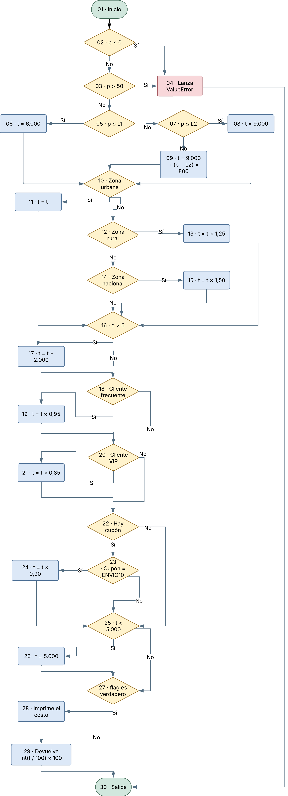
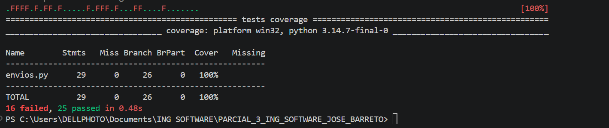
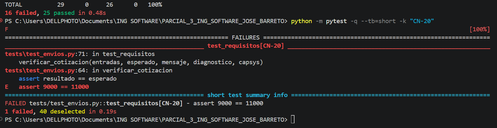
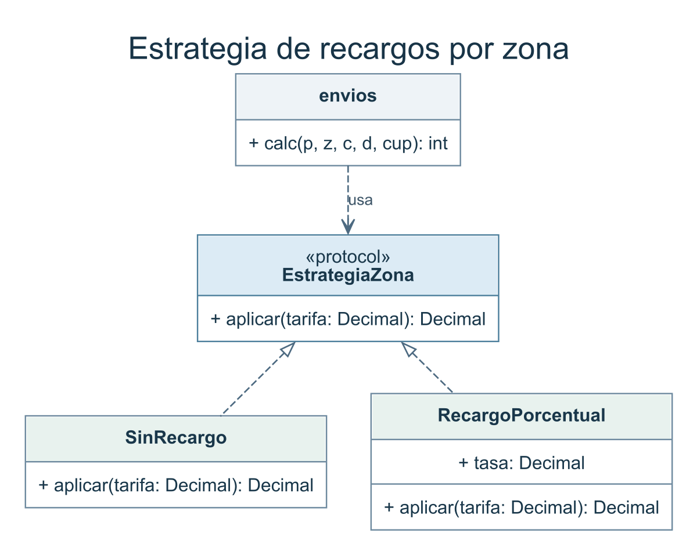
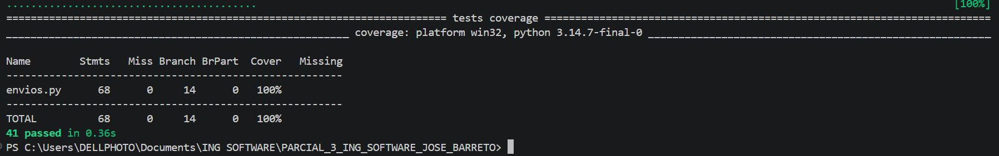

# Parcial n.º 3 de Ingeniería de Software

**Estudiante:** José Carlos Barreto  
**Código estudiantil:** 0182410032

## Mis parámetros

| A | B | C | D | E | F | PMAX | L1 | L2 | RR | RN | V | S | CAMBIO |
| --- | --- | --- | --- | --- | --- | --- | --- | --- | --- | --- | --- | --- | --- |
| 4 | 1 | 0 | 0 | 3 | 2 | 50 kg | 3 kg | 10 kg | 25 % | 50 % | 15 % | $2.000 | 0 |

## Parte 1. Requisitos y criterios de aceptación

### Especificación del cálculo del costo

| ID | Regla (con tus valores) |
| --- | --- |
| R1 | El peso debe cumplir 0 < peso ≤ 50 kg. Si no, se lanza el error “peso inválido”. |
| R2 | Si la zona no es una de las tres válidas, o el día no está entre 1 y 7, se lanza un error. |
| R3 | Tarifa base. Tramo 1 (peso ≤ 3 kg): $6.000. Tramo 2 (hasta 10 kg, inclusive): $9.000. Más de 10 kg: $9.000 + $800 por cada kg sobre 10 kg, de forma proporcional. |
| R4 | Recargo por zona. Rural: +25 %. Nacional: +50 %. Urbana: sin recargo. |
| R5 | Fin de semana (sábado y domingo): +$2.000, después de los descuentos. |
| R6 | Descuento de cliente. Frecuente: 5 %. VIP: 15 %. Cupón ENVIO10: 10 %. Si hay los dos, se aplican ambos: primero el del cliente y luego el cupón. |
| R7 | Un cupón que no existe se ignora. |
| R8 | El costo nunca es menor que $5.000. El resultado se redondea al múltiplo de $100 más cercano; los $50 redondean hacia arriba. |

### Historias de usuario y criterios de aceptación

#### HU-01. Validar los datos de la cotización

Como auxiliar de recepción, quiero validar el peso, la zona y el día del envío para detectar datos incorrectos antes de comunicar un precio.

| DADO | CUANDO | ENTONCES |
| --- | --- | --- |
| Un envío urbano de 50 kg, para un cliente normal, el día 3 y sin cupón. Se considera también cada variante por separado: peso de 0 o 50,01 kg, zona «costera» o día 0. | El auxiliar solicita una cotización para el envío original y para cada variante. | El envío original se acepta y cuesta $41.000. Un peso de 0 o 50,01 kg genera el error «peso inválido» (R1). La zona «costera» y el día 0 generan un error por el dato inválido (R2). |

#### HU-02. Calcular la tarifa por peso y destino

Como asesor de envíos, quiero calcular la tarifa según el tramo de peso y la zona de destino para poder explicar el precio al cliente.

| DADO | CUANDO | ENTONCES |
| --- | --- | --- |
| Tres envíos para clientes normales, el día 4 y sin cupón: urbano de 3 kg, rural de 10 kg y nacional de 10,5 kg. | El asesor cotiza cada envío. | Urbano: 3 kg aún pertenece al primer tramo y cuesta $6.000. Rural: $9.000 más 25 % da $11.250, que se redondea a $11.300. Nacional: $9.400 de base más 50 % da $14.100 (R3, R4, R8). |

#### HU-03. Aplicar descuentos y recargos al total

Como cliente de EnvíaYa, quiero que la cotización aplique mis descuentos y el recargo de fin de semana en el orden correcto para conocer el importe final.

| DADO | CUANDO | ENTONCES |
| --- | --- | --- |
| Tres envíos: rural de 4 kg, VIP, sábado y ENVIO10; rural de 4 kg, frecuente, domingo y cupón desconocido; urbano de 2 kg, VIP, día 3 y ENVIO10. | El cliente confirma los datos y solicita el total de cada envío. | En el primero se descuenta 15 % y luego 10 %. Se suman $2.000 y el total redondeado es $10.600. En el segundo se aplica 5 %, se ignora el cupón y se suman $2.000 al final. El total es $12.700. En el tercero, los descuentos dejan $4.590 y se cobra el mínimo de $5.000 (R5–R8). |

### Matriz de trazabilidad

Los códigos CN identifican los casos de caja negra vinculados con los criterios de aceptación.

| Requisito | Historia | Casos de prueba |
| --- | --- | --- |
| R1 · Peso válido | HU-01 | CN-01: 50 kg aceptados. CN-02: 0 kg rechazados. CN-03: 50,01 kg rechazados. |
| R2 · Zona y día válidos | HU-01 | CN-04: zona «costera» rechazada. CN-05: día 0 rechazado. |
| R3 · Tarifa por peso | HU-02 | CN-06: 3 kg en el primer tramo. CN-07: 10 kg en el segundo. CN-08: 10,5 kg con cobro proporcional. |
| R4 · Recargo por zona | HU-02 | CN-06: urbana sin recargo. CN-07: rural +25 %. CN-08: nacional +50 %. |
| R5 · Fin de semana | HU-03 | CN-09: sábado. CN-10: domingo. En ambos se suman $2.000 después de los descuentos. |
| R6 · Descuentos | HU-03 | CN-09: VIP y ENVIO10, en ese orden. CN-10: cliente frecuente, 5 %. |
| R7 · Cupón desconocido | HU-03 | CN-10: se ignora el cupón desconocido y se devuelve $12.700. |
| R8 · Mínimo y redondeo | HU-02, HU-03 | CN-07: $11.250 suben a $11.300. CN-11: $4.590 se ajustan al mínimo de $5.000. |

## Parte 2. Plan de pruebas

### 2.1 Alcance

Verificar el cotizador de EnvíaYa frente a R1–R8: validación del peso, la zona y el día; tarifas por tramo y destino; descuentos, cupón, recargo de fin de semana, mínimo y redondeo. Se evaluará el comportamiento del código heredado `v1.0.0` y se repetirá la suite después de las correcciones.

### 2.2 Niveles de prueba

**Unidad.** Ejecutar `calc` con entradas controladas. Verificar, por ejemplo, que 3 kg permanezcan en el primer tramo y que $11.250 se redondeen a $11.300.

**Integración.** Comprobar la interacción entre tarifa base, recargo rural, descuento VIP, `ENVIO10` y recargo del sábado. Tras la refactorización, verificar que las funciones extraídas mantengan ese orden al trabajar juntas.

**Sistema.** Ejecutar el cotizador completo desde su entrada pública con solicitudes válidas e inválidas. Comprobar el importe final o el error que corresponda a cada solicitud.

**Aceptación.** Ejecutar los criterios de HU-01 a HU-03 y registrar el resultado con su ID de prueba. Incluir un cupón desconocido y verificar que se ignore y se devuelva el total.

### 2.3 Estrategia, ambiente y roles

Diseñar al menos 20 casos de caja negra a partir de particiones, valores límite y una tabla de decisión. Justificar al menos cinco resultados con cálculos manuales. Diseñar los casos de caja blanca a partir del grafo de `calc` y relacionar las pruebas con la matriz de trazabilidad. Automatizar la ejecución, registrar defectos y repetir la suite en la versión corregida.

**Ambiente.** Python 3 en Windows, terminal PowerShell, entorno virtual, pytest, pytest-cov y Git. Registrar la versión de las herramientas y el commit evaluado junto con cada evidencia.

**Roles.** Análisis de pruebas: diseña los casos y calcula los resultados esperados. Ejecución: automatiza, ejecuta y conserva las evidencias. Mantenimiento: corrige los defectos y revisa la regresión.

### 2.4 Riesgos y mitigaciones

Error al clasificar el peso. Probar valores inferiores, iguales y superiores a los límites, con énfasis en 3 kg y 10 kg.

Redondeo anticipado u orden incorrecto de descuentos. Conservar los subtotales del cálculo manual y verificar un empate de $50 y un envío con descuento y recargo de fin de semana.

Pérdida de la evidencia inicial. Ejecutar y guardar los resultados de la versión heredada antes de incorporar las correcciones.

### 2.5 Criterios de entrada y salida

**Entrada.** Especificación R1–R8 y parámetros revisados, versión `v1.0.0` identificada, ambiente listo y casos con entradas y resultados esperados definidos para la ejecución.

**Salida.** Casos ejecutados y trazados, defectos reproducibles documentados, y regresión aprobada en la versión corregida. Guardar capturas y registrar el porcentaje de casos aprobados, los defectos por severidad, su densidad y la cobertura de sentencias y de ramas. Comparar ambas coberturas entre versiones.

## Parte 3. Diseño de casos de caja negra

El diseño usa la especificación R1–R8 y reúne 26 casos. Los resultados de la matriz son los valores esperados que se verificarán al ejecutar las pruebas.

### 3.1 Particiones de equivalencia

Una partición agrupa entradas que reciben el mismo tratamiento. La tabla identifica las clases de cada dato de la cotización.

| Entrada | Clases válidas | Clases inválidas o tratamiento especial |
| --- | --- | --- |
| Peso (kg) | 0 < p ≤ 3; 3 < p ≤ 10; 10 < p ≤ 50. | p ≤ 0 y p > 50. Se devuelve «peso inválido». |
| Zona | Urbana, rural y nacional. Cada zona tiene un recargo distinto. | Zona fuera del catálogo. Se devuelve un error de zona. |
| Cliente | Normal, frecuente y VIP. Cada tipo tiene un descuento propio. | Tipo fuera del catálogo. La especificación no define qué respuesta debe producir. |
| Día | Enteros del 1 al 5, sábado (6) y domingo (7). | Entero menor que 1 o mayor que 7. Se devuelve un error de día. Los valores no enteros quedan fuera del dominio descrito. |
| Cupón | Ausente o ENVIO10. | Código desconocido. Se ignora y se calcula como si estuviera ausente. |

### 3.2 Valores límite de peso

Se usa un paso de 0,01 kg para comparar cada límite con sus vecinos. El peso de 3 kg se cobra en el primer tramo. A 10,01 kg la base aumenta \$8, aunque el total urbano siga siendo \$9.000 tras redondear. CN-08 permite observar un incremento proporcional en el resultado final.

| Límite | Por debajo | En el límite | Por encima |
| --- | --- | --- | --- |
| 0 kg | −0,01 kg · CN-12 | 0 kg · CN-02 | 0,01 kg · CN-13 |
| 3 kg (L1) | 2,99 kg · CN-14 | 3 kg · CN-06 | 3,01 kg · CN-15 |
| 10 kg (L2) | 9,99 kg · CN-16 | 10 kg · CN-26 | 10,01 kg · CN-17 |
| 50 kg (PMAX) | 49,99 kg · CN-18 | 50 kg · CN-01 | 50,01 kg · CN-03 |

### 3.3 Tabla de decisión

A representa la tarifa base con el recargo de zona aplicado. Cada fila cubre dos situaciones, día hábil y fin de semana. Las multiplicaciones se aplican de izquierda a derecha. Después del importe indicado se aplica el mínimo de \$5.000 y el redondeo a \$100. Un cupón desconocido se trata como ausente.

| Cliente | Cupón | Días 1–5 | Días 6–7 |
| --- | --- | --- | --- |
| Normal | Ausente | A | A + \$2.000 |
| Normal | ENVIO10 | A × 0,90 | A × 0,90 + \$2.000 |
| Normal | Desconocido | A | A + \$2.000 |
| Frecuente | Ausente | A × 0,95 | A × 0,95 + \$2.000 |
| Frecuente | ENVIO10 | A × 0,95 × 0,90 | A × 0,95 × 0,90 + \$2.000 |
| Frecuente | Desconocido | A × 0,95 | A × 0,95 + \$2.000 |
| VIP | Ausente | A × 0,85 | A × 0,85 + \$2.000 |
| VIP | ENVIO10 | A × 0,85 × 0,90 | A × 0,85 × 0,90 + \$2.000 |
| VIP | Desconocido | A × 0,85 | A × 0,85 + \$2.000 |

### 3.4 Matriz de casos de prueba

Cada fila muestra las entradas en orden de peso, zona, cliente, día y cupón. El resultado esperado se deriva de R1–R8. La columna «Técnica» indica la técnica principal que originó el caso.

| ID | Requisito | Entradas | Resultado esperado | Técnica |
| --- | --- | --- | --- | --- |
| CN-01 | R1, R3 | 50 kg · Urbana · Normal · día 3 · sin cupón | \$41.000 | Límite |
| CN-02 | R1 | 0 kg · Urbana · Normal · día 3 · sin cupón | Error «peso inválido» | Límite |
| CN-03 | R1 | 50,01 kg · Urbana · Normal · día 3 · sin cupón | Error «peso inválido» | Límite |
| CN-04 | R2 | 2 kg · «costera» · Normal · día 3 · sin cupón | Error de zona | Partición |
| CN-05 | R2 | 2 kg · Rural · Normal · día 0 · sin cupón | Error de día | Límite |
| CN-06 | R3, R4 | 3 kg · Urbana · Normal · día 4 · sin cupón | \$6.000 | Límite |
| CN-07 | R3, R4, R8 | 10 kg · Rural · Normal · día 4 · sin cupón | \$11.300 | Límite |
| CN-08 | R3, R4 | 10,5 kg · Nacional · Normal · día 4 · sin cupón | \$14.100 | Partición |
| CN-09 | R4–R6, R8 | 4 kg · Rural · VIP · día 6 · ENVIO10 | \$10.600 | Decisión |
| CN-10 | R5–R8 | 4 kg · Rural · Frecuente · día 7 · OTRO | \$12.700 | Decisión |
| CN-11 | R6, R8 | 2 kg · Urbana · VIP · día 3 · ENVIO10 | \$5.000 | Decisión |
| CN-12 | R1 | -0,01 kg · Urbana · Normal · día 3 · sin cupón | Error «peso inválido» | Límite |
| CN-13 | R1, R3 | 0,01 kg · Urbana · Normal · día 3 · sin cupón | \$6.000 | Límite |
| CN-14 | R3 | 2,99 kg · Urbana · Normal · día 4 · sin cupón | \$6.000 | Límite |
| CN-15 | R3 | 3,01 kg · Urbana · Normal · día 4 · sin cupón | \$9.000 | Límite |
| CN-16 | R3 | 9,99 kg · Urbana · Normal · día 4 · sin cupón | \$9.000 | Límite |
| CN-17 | R3, R8 | 10,01 kg · Urbana · Normal · día 4 · sin cupón | \$9.000 | Límite |
| CN-18 | R1, R3, R8 | 49,99 kg · Urbana · Normal · día 3 · sin cupón | \$41.000 | Límite |
| CN-19 | R2, R5 | 4 kg · Urbana · Normal · día 5 · sin cupón | \$9.000 | Límite |
| CN-20 | R2, R5 | 4 kg · Urbana · Normal · día 6 · sin cupón | \$11.000 | Límite |
| CN-21 | R6, R8 | 4 kg · Urbana · VIP · día 4 · sin cupón | \$7.700 | Partición |
| CN-22 | R2 | 4 kg · Urbana · Normal · día 8 · sin cupón | Error de día | Límite |
| CN-23 | R2, R5 | 4 kg · Urbana · Normal · día 1 · sin cupón | \$9.000 | Límite |
| CN-24 | R5–R8 | 4 kg · Rural · Frecuente · día 7 · sin cupón | \$12.700 | Decisión |
| CN-25 | R6 | 4 kg · Urbana · Normal · día 4 · ENVIO10 | \$8.100 | Decisión |
| CN-26 | R3 | 10 kg · Urbana · Normal · día 4 · sin cupón | \$9.000 | Límite |

### 3.5 Cálculo de resultados esperados

**CN-06.** El peso de 3 kg pertenece al primer tramo. La base es \$6.000. Como la zona es urbana, el cliente es normal y el día es hábil, no se aplican ajustes. El mínimo y el redondeo dejan el total en \$6.000.

**CN-07.** 10 kg pertenece al segundo tramo, con base de \$9.000. Zona rural: \$9.000 × 1,25 = \$11.250. Sin otros ajustes, el importe queda justo a mitad entre \$11.200 y \$11.300. Se redondea hacia arriba a \$11.300.

**CN-08.** El exceso es 10,5 − 10 = 0,5 kg. Base: \$9.000 + 0,5 × \$800 = \$9.400. Zona nacional: \$9.400 × 1,50 = \$14.100. El total queda en \$14.100.

**CN-09.** Base de \$9.000. Zona rural: \$9.000 × 1,25 = \$11.250. VIP: \$11.250 × 0,85 = \$9.562,50. ENVIO10: \$9.562,50 × 0,90 = \$8.606,25. Sábado: \$8.606,25 + \$2.000 = \$10.606,25. Total redondeado: \$10.600.

**CN-10.** Base de \$9.000 y recargo rural de 25 %: \$11.250. Cliente frecuente: \$11.250 × 0,95 = \$10.687,50. El cupón OTRO se ignora. Domingo: \$10.687,50 + \$2.000 = \$12.687,50. Total redondeado: \$12.700.

**CN-11.** Base urbana de \$6.000. VIP: \$6.000 × 0,85 = \$5.100. ENVIO10: \$5.100 × 0,90 = \$4.590. Al aplicar el mínimo se obtienen \$5.000, que ya es múltiplo de \$100.

## Parte 4. Diseño de casos de caja blanca

### 4.1 Grafo de flujo

El grafo muestra el flujo de `calc` en la etiqueta `v1.0.0`. Los rombos representan condiciones y los rectángulos indican instrucciones. El error de peso y el retorno normal llevan a la salida común 30.



*Figura 1. Grafo de flujo de calc en la versión heredada.*

### 4.2 Complejidad ciclomática

Se cuentan 30 nodos y 43 aristas. La salida común 30 reúne tanto la excepción del peso como el retorno normal. El grafo contiene 14 predicados con dos salidas cada uno.

| Método | Cálculo | Resultado |
| --- | --- | --- |
| Aristas y nodos | V(G) = E − N + 2 = 43 − 30 + 2. El grafo tiene una entrada y una salida común. | 15 |
| Nodos predicado | V(G) = P + 1 = 14 + 1. La condición compuesta del peso se divide por cortocircuito en los nodos 02 y 03. | 15 |
| Regiones | 14 interiores y 1 exterior. Interiores por bloque: validación (2), tarifa (2), zona (3), fin de semana (1), cliente (2), cupón (2), mínimo (1) y flag (1). | 15 |

### 4.3 Caminos independientes y casos de prueba

La tabla contiene 15 recorridos independientes, verificados con sus vectores de aristas. Las referencias entre paréntesis reutilizan casos de caja negra. En cada recorrido se usa `flag=False`, salvo cuando la entrada indica `flag=True`. El resultado esperado se toma de la especificación y el observado se obtuvo ejecutando `v1.0.0`.

| Camino y referencia | Entradas y foco | Secuencia de nodos | Esperado | Observado en v1.0.0 |
| --- | --- | --- | --- | --- |
| CB-01 (CN-14) | Base urbana. 2,99 kg · urbana · normal · día 4 · sin cupón. | 01 → 02 → 03 → 05 → 06 → 10 → 11 → 16 → 18 → 20 → 22 → 25 → 27 → 29 → 30 | \$6.000 | \$6.000 |
| CB-02 (CN-02) | Peso igual a cero. 0 kg · urbana · normal · día 3 · sin cupón. | 01 → 02 → 04 → 30 | Error «peso inválido» | ValueError «peso invalido» |
| CB-03 (CN-03) | Peso superior al máximo. 50,01 kg · urbana · normal · día 3 · sin cupón. | 01 → 02 → 03 → 04 → 30 | Error «peso inválido» | ValueError «peso invalido» |
| CB-04 (CN-15) | Segundo tramo. 3,01 kg · urbana · normal · día 4 · sin cupón. | 01 → 02 → 03 → 05 → 07 → 08 → 10 → 11 → 16 → 18 → 20 → 22 → 25 → 27 → 29 → 30 | \$9.000 | \$9.000 |
| CB-05 (CN-17) | Tarifa proporcional. 10,01 kg · urbana · normal · día 4 · sin cupón. | 01 → 02 → 03 → 05 → 07 → 09 → 10 → 11 → 16 → 18 → 20 → 22 → 25 → 27 → 29 → 30 | \$9.000 | \$9.000 |
| CB-06 | Recargo rural. 2,99 kg · rural · normal · día 4 · sin cupón. | 01 → 02 → 03 → 05 → 06 → 10 → 12 → 13 → 16 → 18 → 20 → 22 → 25 → 27 → 29 → 30 | \$7.500 | \$7.500 |
| CB-07 | Recargo nacional. 2,99 kg · nacional · normal · día 4 · sin cupón. | 01 → 02 → 03 → 05 → 06 → 10 → 12 → 14 → 15 → 16 → 18 → 20 → 22 → 25 → 27 → 29 → 30 | \$9.000 | \$9.000 |
| CB-08 (CN-04) | Zona fuera del catálogo. 2 kg · costera · normal · día 3 · sin cupón. | 01 → 02 → 03 → 05 → 06 → 10 → 12 → 14 → 16 → 18 → 20 → 22 → 25 → 27 → 29 → 30 | Error de zona | \$6.000 |
| CB-09 | Rama del domingo. 2,99 kg · urbana · normal · día 7 · sin cupón. | 01 → 02 → 03 → 05 → 06 → 10 → 11 → 16 → 17 → 18 → 20 → 22 → 25 → 27 → 29 → 30 | \$8.000 | \$8.000 |
| CB-10 | Descuento frecuente. 2,99 kg · urbana · frecuente · día 4 · sin cupón. | 01 → 02 → 03 → 05 → 06 → 10 → 11 → 16 → 18 → 19 → 20 → 22 → 25 → 27 → 29 → 30 | \$5.700 | \$5.700 |
| CB-11 | Descuento VIP. 2,99 kg · urbana · vip · día 4 · sin cupón. | 01 → 02 → 03 → 05 → 06 → 10 → 11 → 16 → 18 → 20 → 21 → 22 → 25 → 27 → 29 → 30 | \$5.100 | \$5.100 |
| CB-12 | Cupón desconocido. 2,99 kg · urbana · normal · día 4 · OTRO. | 01 → 02 → 03 → 05 → 06 → 10 → 11 → 16 → 18 → 20 → 22 → 23 → 25 → 27 → 29 → 30 | \$6.000 | \$6.000 |
| CB-13 (CN-25) | Cupón válido. 4 kg · urbana · normal · día 4 · ENVIO10. | 01 → 02 → 03 → 05 → 07 → 08 → 10 → 11 → 16 → 18 → 20 → 22 → 23 → 24 → 25 → 27 → 29 → 30 | \$8.100 | \$8.100 |
| CB-14 (CN-11) | Activación del mínimo. 2 kg · urbana · vip · día 3 · ENVIO10. | 01 → 02 → 03 → 05 → 06 → 10 → 11 → 16 → 18 → 20 → 21 → 22 → 23 → 24 → 25 → 26 → 27 → 29 → 30 | \$5.000 | \$5.000 |
| CB-15 | Impresión de diagnóstico. 2,99 kg · urbana · normal · día 4 · sin cupón · flag=True. | 01 → 02 → 03 → 05 → 06 → 10 → 11 → 16 → 18 → 20 → 22 → 25 → 27 → 28 → 29 → 30 | \$6.000 y una impresión de diagnóstico | \$6.000 e imprime «costo: 6000» |

En CB-08, la zona desconocida recorre las tres salidas No del bloque de zona. La versión heredada devuelve \$6.000 aunque R2 exige un error. En CB-12, ignorar el cupón desconocido sí cumple R7. CB-15 documenta la impresión del argumento `flag` en la versión heredada.

### 4.4 Cobertura de sentencias y ramas

**Sentencias.** CB-02, CB-04, CB-05, CB-06, CB-07, CB-09, CB-10, CB-14, CB-15 recorren conjuntamente todos los nodos ejecutables de `calc` en el grafo. Este conjunto incluye las dos formas de salir de la función: la instrucción que lanza el error de peso y el retorno normal. También alcanza la impresión de diagnóstico.

**Ramas.** La suite completa CB-01 a CB-15 recorre las 43 aristas del grafo. La tabla identifica un caso que toma cada salida Sí y No de los 14 predicados. Esta es la cobertura prevista por el diseño. En la Parte 5 se registrará la medición de la herramienta.

| Nodo predicado | Salida Sí | Salida No |
| --- | --- | --- |
| 02 · p ≤ 0 | CB-02 | CB-01 |
| 03 · p > 50 | CB-03 | CB-01 |
| 05 · p ≤ L1 | CB-01 | CB-04 |
| 07 · p ≤ L2 | CB-04 | CB-05 |
| 10 · Zona urbana | CB-01 | CB-06 |
| 12 · Zona rural | CB-06 | CB-07 |
| 14 · Zona nacional | CB-07 | CB-08 |
| 16 · d > 6 | CB-09 | CB-01 |
| 18 · Cliente frecuente | CB-10 | CB-01 |
| 20 · Cliente VIP | CB-11 | CB-01 |
| 22 · Hay cupón | CB-12 | CB-01 |
| 23 · Cupón = ENVIO10 | CB-13 | CB-12 |
| 25 · t < 5.000 | CB-14 | CB-01 |
| 27 · flag es verdadero | CB-15 | CB-01 |

## Parte 5. Automatización, ejecución y defectos

### 5.1 Suite y ejecución del código heredado

La suite tests/test_envios.py parametriza los casos CN y CB de las partes 3 y 4. Verifica importes, excepciones y la impresión de diagnóstico del caso CB-15. Cada prueba conserva su ID, incluso cuando un caso de caja blanca reutiliza entradas de caja negra. Se ejecutó sobre el archivo envios.py de v1.0.0.

Entorno de ejecución: Python 3.12.14, pytest 9.2.0, pytest-cov 7.1.0 y Coverage.py 7.17.2. Las figuras 2 y 3 son capturas de una repetición en PowerShell con Python 3.14.7. La repetición confirmó los mismos totales y cobertura.

```powershell
python -m pytest -q --tb=short --cov=envios --cov-branch --cov-report=term-missing --cov-report=json:coverage.json
```



*Figura 2. Resumen y cobertura de la suite completa en PowerShell.*



*Figura 3. Caso CN-20 ejecutado de forma aislada en PowerShell.*

### 5.2 Registro y reproducción de defectos

Se registró un defecto por causa de incumplimiento. La severidad mide el impacto y la prioridad indica el orden de atención: P1 inmediata, P2 siguiente y P3 posterior. Para reproducir un defecto, ejecutar la cotización indicada en v1.0.0 y comparar el resultado.

| Defecto | Requisito | Severidad / prioridad | Casos de referencia |
| --- | --- | --- | --- |
| DEF-01 · Mensaje de peso inválido sin tilde | R1 | Baja / P3 | CN-02 |
| DEF-02 · La zona desconocida recibe una tarifa | R2 | Alta / P1 | CN-04 |
| DEF-03 · Días fuera del rango pasan la validación | R2 | Alta / P1 | CN-05, CN-22 |
| DEF-04 · El sábado queda sin recargo | R5 | Alta / P1 | CN-20 |
| DEF-05 · El recargo dominical se descuenta | R5 | Media / P2 | CN-24 |
| DEF-06 · El resultado se trunca al centenar inferior | R8 | Media / P2 | CN-07, CN-21 |

#### DEF-01 · Mensaje de peso inválido sin tilde

Reproducción. Cotizar 0 kg, zona urbana, cliente normal, día 3 y sin cupón. Esperado: ValueError con «peso inválido». Obtenido: ValueError con «peso invalido». Justificación: El rechazo funciona. El texto incumple el mensaje exigido en R1 (línea 12).

#### DEF-02 · La zona desconocida recibe una tarifa

Reproducción. Cotizar 2 kg, zona «costera», cliente normal, día 3 y sin cupón. Esperado: Error de zona. Obtenido: \$6.000. Justificación: El bloque de zonas (líneas 19–24) deja pasar una zona fuera del catálogo y puede producir un cobro inválido.

#### DEF-03 · Días fuera del rango pasan la validación

Reproducción. Cotizar 2 kg, zona rural, cliente normal, día 0 y sin cupón. Esperado: Error de día. Obtenido: \$7.500. Justificación: Se genera un precio con una fecha inválida. La condición de la línea 26 calcula un recargo pero no valida el rango.

#### DEF-04 · El sábado queda sin recargo

Reproducción. Cotizar 4 kg, zona urbana, cliente normal, día 6 y sin cupón. Esperado: \$11.000. Obtenido: \$9.000. Justificación: La condición d > 6 omite el sábado (línea 26). Este caso aísla el recargo porque el cliente es normal y no hay cupón.

#### DEF-05 · El recargo dominical se descuenta

Reproducción. Cotizar 4 kg, zona rural, cliente frecuente, día 7 y sin cupón. Esperado: \$12.700. Obtenido: \$12.500. Justificación: El recargo se suma en las líneas 26–27 antes del descuento. El subtotal heredado es \$12.587,50 y su redondeo correcto daría \$12.600. Así se distingue este defecto del truncamiento.

#### DEF-06 · El resultado se trunca al centenar inferior

Reproducción. Cotizar 4 kg, zona urbana, cliente VIP, día 4 y sin cupón. Esperado: \$7.700. Obtenido: \$7.600. Justificación: El subtotal de \$7.650 debe redondear hacia arriba. La línea 39 descarta los \$50 en vez de aplicar el redondeo.

### 5.3 Métricas de la ejecución inicial

| Métrica | Resultado | Base de cálculo |
| --- | --- | --- |
| Casos ejecutados | 41 | 26 de caja negra + 15 de caja blanca |
| Casos aprobados | 25 (60,98 %) | 25 ÷ 41 × 100 |
| Casos fallidos | 16 | Resultados que difieren de la especificación |
| Defectos por severidad | 3 altos, 2 medios, 1 bajo | Conteo de defectos únicos |
| Densidad de defectos | 16,22 por cada 100 líneas | 6 ÷ 37 × 100 |
| Cobertura de sentencias | 100 % | 29 de 29 sentencias medidas |
| Cobertura de ramas | 100 % | 26 de 26 ramas medidas |

La densidad usa las 37 líneas físicas de envios.py sin comentarios ni líneas en blanco. La cobertura de ramas de la herramienta usa transiciones entre líneas. En el grafo, la condición del peso se separa en dos predicados para analizar el cortocircuito.

El 100 % de cobertura indica que la suite recorrió todo lo que mide la herramienta. Los 16 fallos muestran que recorrer el código y cumplir los requisitos son comprobaciones distintas.

## Parte 6. Mantenimiento y refactorización

### 6.1 Malos olores y deuda técnica

Las líneas corresponden a envios.py en la etiqueta v1.0.0.

| Mal olor | Líneas | Deuda técnica |
| --- | --- | --- |
| Método largo | 10–39 | calc mezcla validación, cálculo, descuentos, salida de diagnóstico y redondeo. Una corrección obliga a revisar responsabilidades ajenas. |
| Números mágicos | 11, 14, 16, 18, 29, 35 y 39 | Los límites, importes y factores incrustados dificultan localizar las reglas y actualizar sus valores de forma coherente. |
| Nombres crípticos | 10, 14 y 18 | p, z, c, d y t requieren reconstruir el significado a partir del contexto. |
| Condicional por tipo | 19–24 | Cada destino agrega una rama dentro de calc. Extender el catálogo obliga a modificar el cálculo principal. |
| Instrucción redundante | 20 | t = t ocupa una rama sin transformar el importe y oculta la intención de la tarifa urbana. |
| Argumento bandera | 10 y 37–38 | flag mezcla el cálculo con la impresión y amplía la interfaz pública con un efecto de diagnóstico. |
| Condicional anidado | 32–34 | La validación y el descuento del cupón quedan implícitos en el anidamiento, lo que dificulta localizar la política del cupón. |

### 6.2 Cambios y tipo de mantenimiento

| Cambio | Tipo | Motivo |
| --- | --- | --- |
| DEF-01 | Correctivo | Se corrige el texto de la excepción de peso. |
| DEF-02 y DEF-03 | Correctivo | La zona debe pertenecer al catálogo y el día al rango 1–7. |
| DEF-04 y DEF-05 | Correctivo | El recargo aplica el sábado y el domingo después de los descuentos. |
| DEF-06 | Correctivo | Se usa Decimal y redondeo a centenas con ROUND_HALF_UP. |
| Extraer validación, tarifa, descuentos y total | Perfectivo | Aísla responsabilidades y reduce la complejidad de calc. |
| Constantes con nombres | Preventivo | Centraliza las reglas de peso, tarifa y redondeo para reducir inconsistencias. |
| Estrategia de recargo por zona | Preventivo | Permite seleccionar una política de zona sin añadir ramas a calc. |
| Retiro de flag | Perfectivo | Simplifica la firma y elimina la impresión de diagnóstico del cotizador. |

### 6.3 Patrón Estrategia aplicado a zonas

calc selecciona una EstrategiaZona mediante el catálogo de destinos. SinRecargo conserva el importe urbano y RecargoPorcentual aplica la tasa configurada para rural o nacional. El cotizador usa la misma operación aplicar en los tres destinos.



*Figura 4. Diagrama UML de las estrategias de recargo por zona.*

### 6.4 Regresión y comparación

La suite corregida aprobó 41 de 41 casos. Se conservaron las entradas, los IDs y los resultados esperados de negocio. CB-15 conserva el importe esperado y comprueba la ausencia del argumento flag y de la impresión. La evidencia del diagnóstico original permanece en la Parte 5.

La Figura 5 corresponde a la repetición en PowerShell con Python 3.14.7 y Coverage.py 7.17.2. En esa ejecución se midieron 68 sentencias, porque la anotación tasa: Decimal de la línea 38 no se contó como ejecutable. La tabla usa la medición de referencia con Python 3.12.14 (69 sentencias). Ambas ejecuciones aprobaron los 41 casos y cubrieron las 14 ramas.



*Figura 5. Regresión en PowerShell sobre la versión corregida: 41 pruebas aprobadas y cobertura del 100 %.*

| Métrica | Código heredado | Código corregido |
| --- | --- | --- |
| Casos aprobados | 25 de 41 | 41 de 41 |
| Casos fallidos | 16 | 0 |
| Complejidad ciclomática de calc | 15 | 1 |
| Líneas físicas de envios.py | 39 | 107 |
| Líneas sin vacías ni comentarios | 37 | 80 |
| Cobertura de sentencias | 100 % · 29/29 | 100 % · 69/69 |
| Cobertura de ramas | 100 % · 26/26 | 100 % · 14/14 |

calc coordina las etapas. Al desglosar el cortocircuito, _validar_peso tiene complejidad 4 y _tarifa_base tiene 3. El archivo crece al introducir constantes, funciones y clases. En la versión corregida, Coverage.py excluye cuatro líneas de la declaración del protocolo.

## Parte 7. Control de versiones y publicación

### Integración de los cambios

La etiqueta v1.0.0 identifica el código heredado en ca3081b. La suite de pruebas se incorporó desde test/suite, los seis defectos se corrigieron por separado en fix/DEF-01 a fix/DEF-06 y el diseño por estrategias de zona se integró desde refactor/estrategia. El historial de main conserva los merges de estas ocho ramas.

### Versión y compatibilidad

Se propone v2.0.0 según el versionado semántico. La firma pública cambia de `calc(p, z, c, d, cup=None, flag=False)` a `calc(p, z, c, d, cup=None)`. Un sexto argumento posicional o el argumento por nombre flag produce TypeError. Para migrar, se elimina ese argumento de las llamadas y se usa el valor devuelto para mostrar el costo cuando corresponda. La regresión de la Parte 6 registró 41 de 41 pruebas aprobadas y 100 % de cobertura de ramas de envios.py.

[CHANGELOG.md](CHANGELOG.md) registra los cambios por versión. [NOTAS_VERSION.md](NOTAS_VERSION.md) contiene el resumen para la publicación y las instrucciones de migración. La etiqueta v2.0.0 corresponde a la versión corregida previa a la solicitud de cambio.

### Historial de Git

Salida de `git log --oneline --graph --all` hasta b04830b, con la Parte 6 integrada.

```text
* b04830b Adjunta la evidencia de regresión de la versión corregida
*   5c6d6d8 Integra la refactorización y la regresión
|\
| * 5a82491 Separa las estrategias de recargo y verifica la regresión
|/
*   3d441cc Integra la corrección DEF-06
|\
| * 1c22823 DEF-06 Redondea al centenar con aritmética decimal
|/
*   6953068 Integra la corrección DEF-05
|\
| * 13e80c1 DEF-05 Suma el recargo después de los descuentos
|/
*   e091547 Integra la corrección DEF-04
|\
| * f2ba9c6 DEF-04 Aplica el recargo también el sábado
|/
*   fe116b4 Integra la corrección DEF-03
|\
| * 78d2b83 DEF-03 Valida el rango del día de envío
|/
*   ecc0873 Integra la corrección DEF-02
|\
| * 158b7b4 DEF-02 Rechaza zonas fuera del catálogo
|/
*   c8f3555 Integra la corrección DEF-01
|\
| * c7a4fb4 DEF-01 Corrige el mensaje de peso inválido
|/
*   fd4059c Integra las pruebas de la versión heredada
|\
| * 0fe893f Automatiza la suite y registra los defectos de la versión heredada
|/
* 98a54ff Documenta los caminos y la cobertura de caja blanca
* 0986915 Documenta el diseño de pruebas de caja negra
* d012004 Documenta el plan de pruebas del cotizador
* 3a09b41 Completa la Parte 1 con requisitos, historias y trazabilidad
* 00d65d9 Documenta los parámetros del parcial
* ca3081b Registra y guarda la versión del código heredada con la configuración personal de los párametros
```

## Parte 8. Solicitud de cambio y análisis de impacto

(4 + 2) mod 3 = 0. Se incorpora San Andrés al catálogo con la clave `insular` y un recargo del 70 % sobre la tarifa base. Si el envío incluye un cupón, `calc` devuelve `ValueError` antes de cotizar.

### Impacto sobre los requisitos

| Requisito | Historia | Casos de prueba | Código afectado |
| --- | --- | --- | --- |
| R2 · Catálogo de destinos | HU-01 | SC-01 y SC-02 aceptan insular. CN-04 sigue rechazando costera. | ESTRATEGIAS_ZONA y _seleccionar_zona |
| R4 · Recargo de zona | HU-02 | SC-01 verifica $6.000 × 1,70 = $10.200. SC-02 parte de $9.000 × 1,70. | RecargoPorcentual y RECARGO_INSULAR |
| R6 y R7 · Cupones | HU-03 | SC-03 rechaza ENVIO10 y SC-04 rechaza OTRO en insular. CN-10 y CN-25 comprueban las reglas fuera de insular. | Validación en calc antes de _aplicar_descuentos |
| R5 y R8 · Recargo de fin de semana y redondeo | HU-03 | SC-02 verifica $15.300 × 0,85 + $2.000 = $15.005, redondeados a $15.000. | Integración con las etapas de fin de semana y total |

### Mantenimiento y regresión

Es mantenimiento perfectivo porque amplía la funcionalidad a un nuevo destino. En feat/zona-insular se escribieron primero los cuatro casos de tests/test_zona_insular.py. Antes de implementar el cambio, los cuatro fallaron porque la versión base rechazaba la zona. Tras incorporar la estrategia y la validación de cupón, aprobaron las 45 pruebas de la suite. Coverage.py registró 72 sentencias y 16 ramas cubiertas, sin faltantes.

[Salida de las pruebas antes y después del cambio](evidencias/verificacion-zona-insular.txt)

### Nueva versión

Se asigna v2.1.0 a la ampliación. `calc(p, z, c, d, cup=None)` conserva su firma y las reglas de las zonas existentes. El cambio agrega un valor válido de zona y una regla propia de ese destino. La rama del cambio es `feat/zona-insular`. Los cambios por versión se registran en [CHANGELOG.md](CHANGELOG.md).
